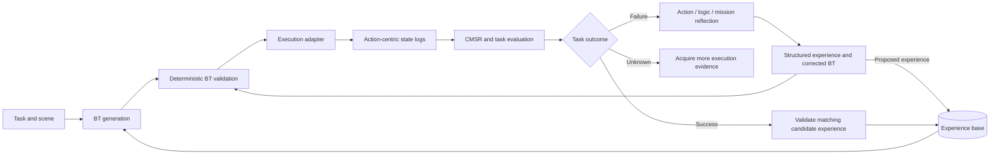

# SRDrone: LLM-Driven Self-Refinement for Embodied Drone Task Planning

[](https://github.com/ZXiiiC/SRDrone/actions/workflows/python.yml)
[](pyproject.toml)
[](LICENSE)

Code accompanying [SRDrone (IEEE Transactions on Mobile Computing, 2026)](https://doi.org/10.1109/TMC.2026.3664806).

[Quick start](#run-the-offline-demonstration) · [Model setup](#use-a-language-model) · [ROS1 integration](docs/EXECUTION.md) · [中文恢复说明](docs/RECOVERY.zh-CN.md)

SRDrone evaluates a drone's full action history, diagnoses failed behavior-tree (BT) plans, and refines them using structured reflective experience. This repository contains the original public ROS1 controller/perception stack and a **reconstructed Python planning runtime**, implemented from the published paper and the author's surviving research notebook. See [recovery provenance](docs/RECOVERY.md) and [中文恢复说明](docs/RECOVERY.zh-CN.md).

The `main` branch includes BT generation, continuous state evaluation, hierarchical reflection, deterministic XML validation, persistent experience storage, and execution adapters. Start with the offline demonstration, then configure a model provider and an execution environment.

## System workflow



A completed BT and a successful mission are evaluated separately. Corrections are checked against the controller interface before execution, and experience validation requires a fresh execution associated with the corrected plan.

## Run the offline demonstration

Python 3.10+ is required. The core Python runtime has no third-party dependencies and does not require ROS, a GPU, an API key, or a drone.

```bash
git clone --branch main https://github.com/ZXiiiC/SRDrone.git
cd SRDrone
python3 -m venv .venv
source .venv/bin/activate
python -m pip install -e .
python -m srdrone demo --output runs/demo
python -m unittest discover -s srdrone/test -v
```

The demo exercises this complete sequence:

1. Read an initial BT and its execution keyframes.
2. Reconstruct an auxiliary ideal trajectory and derive CMSR motion/spatial semantics.
3. Identify a plan-level failure: the BT finishes, but the drone reaches the frame center without passing through it.
4. Diagnose action/logic/mission layers and produce `[OPERATION] + [RATIONALE]` experience.
5. Generate a corrected BT and validate its nodes, ports, structure, and blackboard references.
6. Evaluate a **second execution fixture associated with the corrected plan** and update experience provenance.

Inspect these artifacts under `runs/demo/`:

- `cycle-000/result.json`: initial task evaluation and reflection.
- `cycle-000/candidate.xml`: corrected and syntax-validated BT.
- `cycle-001/result.json`: evaluation of the matching second execution fixture.
- `summary.json`: execution count and final task outcome.

The fixture includes manually authored model responses and trajectories; it verifies software behavior rather than experimental performance. Use a fresh output directory for every run.

To check an existing BT without a model service or ROS:

```bash
python -m srdrone validate examples/notebook_detection_failure.xml
```

## Use a language model

The runtime accepts a Chat Completions compatible endpoint. Configure the model explicitly; the historical paper used GPT-4o at temperature 0.2, while current model availability depends on your provider.

```bash
export SRDRONE_API_KEY='your-provider-key'
export SRDRONE_MODEL='your-provider-model-id'
export SRDRONE_BASE_URL='https://api.openai.com/v1'
export SRDRONE_TEMPERATURE='0.2'
```

Credentials are read from the environment. Model traces save prompts, mission inputs and responses under the selected output directory, without authorization headers. No network calls occur in `demo`, `validate`, or at import time.

Generate a plan:

```bash
python -m srdrone plan \
  --task 'Find a square frame, pass through it, and land.' \
  --output runs/new-plan
```

Evaluate a surviving notebook case and generate a candidate correction:

```bash
python -m srdrone evaluate \
  --task 'Find and pass through a square frame.' \
  --plan examples/notebook_detection_failure.xml \
  --log examples/notebook_detection_failure.txt \
  --reflect --output runs/notebook-case
```

Analyze a full controller BTlog session, including its embedded plan:

```bash
python -m srdrone evaluate \
  --task 'Find a square frame, pass through it, and land.' \
  --log controller/config/BTlog.txt \
  --session-index -1 --reflect --output runs/log-analysis
```

`evaluate` is historical analysis: it exports a candidate but does not execute it or claim that it succeeded. Missing evidence yields `unknown`. The legacy `python -m workflow.cli` entry point now exposes the same subcommands.

## Close the execution loop

`run` sends each plan to an external execution adapter, waits for a fresh result matching the plan digest, evaluates it, and executes a correction only when another iteration is warranted. It allows an initial execution plus up to five refinements.

```bash
python -m srdrone run \
  --task 'Find a square frame, pass through it, and land.' \
  --initial-plan runs/new-plan/plan.xml \
  --exchange runs/mission-exchange \
  --output runs/mission --max-refinements 5
```

In a second terminal, with the prepared simulation environment and sourced catkin workspace, start the ROS1 adapter using the same exchange directory:

```bash
python -m srdrone.ros_adapter \
  --exchange runs/mission-exchange --launch sim \
  --execution-timeout 300 --max-executions 6
```

Use the provided ROS1 adapter in a prepared PX4/RflySim environment, or implement the documented file protocol for another simulator. The ROS adapter launches the flight controller and can arm/move the vehicle; the offline demo never invokes it. See [execution and ROS integration](docs/EXECUTION.md) for configuration and commands. ROS compilation, simulation and physical-flight validation require that environment and have not been performed for this reconstruction.

## Experience retrieval

Experiences persist in SQLite, with source task, task category, source/candidate plan digests, run identity, and validation status. New suggestions are `proposed`. A successful fresh execution in the same run marks the associated candidate's entries `execution_validated`. Only those entries are retrieved for new tasks by default.

For paper-style kNN retrieval:

```bash
python -m pip install -e '.[retrieval]'
```

This uses [`sentence-transformers/all-mpnet-base-v2`](https://huggingface.co/sentence-transformers/all-mpnet-base-v2) and cosine similarity. `--top-k` defaults to 3, an exposed reconstruction choice. `--retriever lexical` selects a small deterministic alternative for smoke tests; it does not reproduce the paper's retrieval method. MPNet weights are downloaded by Sentence Transformers when first used; no original experience bank is bundled.

## Validation and implementation provenance

| Component | Release status |
| --- | --- |
| Python runtime, offline refinement fixture, XML validation and experience persistence | Verified locally; CI runs on Python 3.10 and 3.12 |
| Installable wheel with recovered prompts and demo assets | Built and exercised outside the source checkout |
| Model-provider transport | Local HTTP roundtrip and error handling tested; live-provider inference quality requires evaluation |
| MPNet kNN retrieval | Implemented as an optional dependency; model execution and retrieval quality require evaluation |
| ROS1 adapter and controller integration | Included; Catkin, PX4/RflySim and physical-flight validation require the corresponding environment |

The Python planning runtime was reconstructed from the published paper, eight surviving prompt excerpts and the public controller interfaces. The original private source, complete experimental dataset and trained experience base are unavailable. This release does not claim reproduction of the paper's quantitative results.

See [method-to-code provenance](docs/RECOVERY.md), [validation commands and boundaries](docs/VALIDATION.md), [controller interfaces](docs/INTERFACES.md), and [execution protocol](docs/EXECUTION.md) for details.

## Repository layout

| Path | Purpose |
| --- | --- |
| `srdrone/` | Model transport, BT generator/validator, experience bank, execution adapters and loop |
| `srdrone/prompts/recovered/` | Eight verbatim prompt excerpts from the surviving notebook |
| `srdrone/prompts/manifest.json` | Source line ranges and SHA-256 hashes |
| `evaluator/` | Continuous state capture, CMSR, execution completeness and task evaluation |
| `reflector/` | Hierarchical diagnosis, constraint space and node-level experience |
| `workflow/` | Shared data models, historical BTlog parser and compatibility entry point |
| `controller/` | Original C++ ROS1 BT controller, with configurable plan/log paths and root-status logging |
| `object_det/`, `recognize_aruco/`, `sensor_pkg/`, `common_msgs/` | Existing perception, sensors and ROS messages |
| `examples/` | Surviving notebook case and provenance |
| `srdrone/data/frame_crossing/` | Synthetic offline demo, clearly separated from experiments |

The validator exposes an audited subset of the public controller's actual registered interfaces. Some research-notebook nodes, including `ForwardDetectBalloon`, are absent from the public controller and are intentionally excluded from generation. See the [interface audit](docs/INTERFACES.md).

## License and citation

SRDrone-authored code and the reconstructed runtime use [Apache-2.0](LICENSE), consistent with the existing project metadata. Third-party source retains its own terms. In particular, vendored YOLOv5 files identify GPL-3.0; see [third-party notices](THIRD_PARTY_NOTICES.md). Existing model binaries do not include recovered training/data provenance.

```bibtex
@article{zhang2026srdrone,
  title   = {SRDrone: LLM-Driven Self-Refinement for Embodied Drone Task Planning},
  author  = {Zhang, Deyu and Zhang, Xicheng and Zhang, Jinrui and Li, Jiahao and
             Long, Tingting and Dai, Xunhua and Fu, Yongjian and Ren, Ju and Zhang, Yaoxue},
  journal = {IEEE Transactions on Mobile Computing},
  year    = {2026},
  volume  = {25},
  number  = {7},
  doi     = {10.1109/TMC.2026.3664806}
}
```
